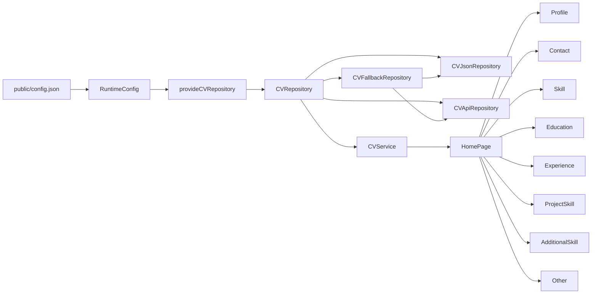

# Portafolio Frontend


Aplicación SPA desarrollada con **Angular 22** que presenta un currículum profesional de forma dinámica. Usa **componentes standalone**, **signals** y **Tailwind CSS**, y sigue una **arquitectura hexagonal ligera**: el dominio no sabe si los datos vienen de un JSON local, de una API REST o de una combinación con fallback, porque el adaptador se elige en tiempo de ejecución desde `public/config.json`.

El objetivo del proyecto es servir como frontend del portafolio personal y, al mismo tiempo, aplicar buenas prácticas de Angular moderno: separación de contenido y presentación, componentes reutilizables, estado reactivo y un contrato de datos fuertemente tipado.

---

## Características

- Renderizado dinámico de todas las secciones del currículum desde un modelo tipado.
- Arquitectura hexagonal: puerto `CVRepository`, adaptadores API/JSON/fallback y servicio de aplicación.
- Fuente de datos seleccionable en runtime sin recompilar (`json`, `api` o `fallback`).
- Fallback automático: intenta la API y cae al JSON si falla o no responde.
- Estado reactivo con `signal`: `cv`, `isLoading` y `error`.
- Componentes standalone independientes por sección, sin `NgModules`.
- Habilidades organizadas por categoría y con jerarquía padre/hijo ilimitada.
- Formateo recursivo de habilidades anidadas, por ejemplo `C# (.NET 6 | .NET 8 (ASP.NET Core | EF Core))`.
- Contactos con enlaces `tel:`, `mailto:`, `url` y `whatsapp`, ordenados por posición.
- Diseño responsive con Tailwind CSS y carga diferida de la página principal.
- Pruebas unitarias con un repositorio en memoria, sin mockear `HttpClient`.
- Cabeceras de seguridad listas para hosting estático.

---

## Stack tecnológico

| Tecnología         | Uso                                                        |
| ------------------ | ---------------------------------------------------------- |
| Angular 22         | Framework de la SPA                                        |
| TypeScript 6       | Tipado estricto del modelo y los componentes               |
| Tailwind CSS 4     | Estilos utilitarios y diseño responsive                    |
| Angular HttpClient | Implementación de los adaptadores JSON y API               |
| Angular Signals    | Estado reactivo de la aplicación                           |
| RxJS               | Composición del adaptador de fallback                      |
| Vitest             | Runner de pruebas configurado mediante `ng test`           |
| Prettier           | Formato consistente del código                             |

---

## Arquitectura



### Flujo de datos

```text
config.json → RuntimeConfig (provideAppInitializer, antes del bootstrap)
       │
       ▼
provideCVRepository (useFactory) elige el adaptador:
   json     → CVJsonRepository
   api      → CVApiRepository
   fallback → CVFallbackRepository (API → JSON)
       │
       ▼
CVService (signals: cv / isLoading / error)
       │
       ▼
HomePage (effect para el título)
       ├── app-profile      ├── app-experience
       ├── app-contact      ├── app-project-skill
       ├── app-skill        ├── app-additional-skill
       ├── app-education    └── app-other
```

La regla de dependencias es unidireccional: `features` y `infrastructure` dependen de `core`, pero `core` no depende de ninguno de los dos. El puerto es una clase abstracta usada como token de inyección.

---

## Estructura del proyecto

```text
portafolio-frontend/
├── public/
│   ├── _headers                    # seguridad + no-cache para config.json
│   ├── config.json                 # fuente de datos en runtime
│   ├── assets/data/cv.json         # no versionado (datos personales)
│   └── assets/images/profile.png   # no versionado (dato personal)
├── src/
│   ├── app/
│   │   ├── core/
│   │   │   ├── domain/cv.model.ts          # iCV y interfaces (sin Angular)
│   │   │   ├── ports/cv.repository.ts      # puerto
│   │   │   └── application/cv.service.ts   # servicio de aplicación
│   │   ├── infrastructure/
│   │   │   ├── cv-api-url.token.ts
│   │   │   ├── cv-api.repository.ts
│   │   │   ├── cv-json.repository.ts
│   │   │   ├── cv-fallback.repository.ts
│   │   │   ├── runtime-config.ts
│   │   │   └── cv.provider.ts
│   │   ├── features/cv/
│   │   │   ├── components/
│   │   │   └── utils/
│   │   ├── pages/home-page/
│   │   ├── app.config.ts
│   │   ├── app.routes.ts
│   │   └── app.ts
│   ├── testing/
│   │   ├── cv-in-memory.repository.ts
│   │   └── fixtures/cv.fixture.ts
│   ├── main.ts
│   └── styles.css
├── angular.json
├── package.json
└── tsconfig.json
```

---

## Configuración de la fuente de datos

`public/config.json` se sirve como archivo estático y se lee antes de arrancar la aplicación:

```json
{
  "dataSource": "json",
  "apiUrl": ""
}
```

| `dataSource` | Adaptador seleccionado | Comportamiento |
| ------------ | ---------------------- | -------------- |
| `json`       | `CVJsonRepository`     | Lee `assets/data/cv.json` (valor por defecto). |
| `api`        | `CVApiRepository`      | GET a `apiUrl` (URL completa del endpoint); falla si la API no responde. |
| `fallback`   | `CVFallbackRepository` | Prueba esa misma URL con timeout de 5 s y cae al JSON. |

`apiUrl` es la URL **completa** del recurso, no solo la base: el adaptador no añade sufijos. Está configurada con el endpoint de desarrollo:

```json
{
  "dataSource": "fallback",
  "apiUrl": "https://localhost:7184/api/v1/Curriculum/53aae2aa-acfc-4c70-b579-49059c4a441b"
}
```

Cambia `dataSource` a `api` si quieres que un fallo de la API se refleje como error en lugar de usar el JSON local. Si `config.json` no existe o no es válido, se aplica la configuración por defecto (`json`). La cabecera `Cache-Control: no-cache` evita que el navegador conserve una configuración antigua.

Para que `https://localhost:7184` funcione desde el navegador hay que cumplir dos requisitos del backend: confiar el certificado de desarrollo (`dotnet dev-certs https --trust`) y permitir CORS desde `http://localhost:4200`. Mientras tanto, `fallback` mantiene la página visible con el JSON local.

---

## Modelo de datos del currículum

Las interfaces viven en `src/app/core/domain/cv.model.ts`; `iCV` agrega las ocho secciones:

| Sección JSON      | Componente        | Contenido                                                        |
| ----------------- | ----------------- | ---------------------------------------------------------------- |
| `profile`         | `Profile`         | Datos generales, cargo y presentación.                           |
| `contact`         | `Contact`         | Medios de contacto con enlaces según su tipo.                    |
| `education`       | `Education`       | Formación académica y certificaciones.                           |
| `categorySkill`   | `Skill`           | Competencias técnicas agrupadas por categoría.                   |
| `experience`      | `Experience`      | Experiencia laboral y tecnologías utilizadas.                    |
| `projectSkill`    | `ProjectSkill`    | Proyectos y habilidades aplicadas.                               |
| `additionalSkill` | `AdditionalSkill` | Conocimientos adicionales.                                       |
| `other`           | `Other`           | Información complementaria (idioma, modalidad, ubicación, etc.). |

El JSON local replica el contrato de la API REST del repositorio `portafolio-backend`, de modo que ambos adaptadores devuelven el mismo tipo `iCV`. Las habilidades pueden tener hijos de forma recursiva; la utilidad `formatSkills` en `src/app/features/cv/utils/skill.utils.ts` las transforma en texto legible.

---

## Decisiones de diseño

- **Hexagonal ligera:** puerto + adaptadores + servicio de aplicación. No se añaden más capas porque sería sobreingeniería para un front; si el proyecto crece, se añade un puerto por agregado (`ProjectsRepository`, etc.).
- **Dominio puro:** `core/domain` contiene solo interfaces, sin dependencias de Angular ni de HTTP.
- **Inversión de dependencias:** `app.config.ts` decide qué adaptador se inyecta; `CVService` solo conoce `CVRepository`.
- **Configuración en runtime:** `provideAppInitializer` lee `config.json` y un `useFactory` resuelve el puerto después, sin recompilar.
- **Fallback compuesto:** el adaptador de fallback reutiliza los otros dos; el `timeout` evita esperar indefinidamente a una API caída.
- **Contrato tipado:** las interfaces reflejan el JSON y el contrato de la API, lo que detecta errores en tiempo de compilación.
- **Utilidades puras:** el formateo de habilidades está aislado en funciones reutilizables y fáciles de probar.
- **Testabilidad:** `CVInMemoryRepository` permite probar el servicio de aplicación sin `HttpClient`.
- **Signals:** el estado (`cv`, `isLoading`, `error`) se expone como señales de solo lectura.
- **Privacidad por defecto:** `cv.json` y `profile.png` no se versionan por contener datos personales; los tests usan un fixture anonimizado.
- **Seguridad:** cabeceras de seguridad en `public/_headers` y controles de seguridad en el repositorio (CodeQL, Dependabot, auditoría de dependencias y protección ante exposición de secretos).
- **Evolución:** `rxResource`/`httpResource` están disponibles en Angular 22. `rxResource` puede sustituir la suscripción manual manteniendo el puerto; `httpResource` conviene usarlo solo dentro de los adaptadores para no acoplar la capa de aplicación a HTTP.

---

## Puesta en marcha

### Requisitos

- [Node.js](https://nodejs.org/) 22.22+ o 24+
- npm 11+

### 1. Instalar dependencias

```bash
npm install
```

### 2. Preparar los datos locales

Crea estos archivos, que no se versionan por contener información personal:

```text
public/assets/data/cv.json
public/assets/images/profile.png
```

El JSON debe respetar `iCV` en `src/app/core/domain/cv.model.ts`. `public/config.json` ya está incluido y por defecto usa el JSON local.

### 3. Ejecutar el servidor de desarrollo

```bash
npm start
```

La aplicación estará disponible en `http://localhost:4200/`.

---

## Build

```bash
npm run build
```

Los artefactos se generan en `dist/portafolio-frontend/browser`. `config.json` y `_headers` se copian automáticamente desde `public/`.

---

## Pruebas

```bash
npm test -- --watch=false
```

| Archivo | Qué cubre |
| ------- | --------- |
| `cv.service.spec.ts` | Estado `cv` / `isLoading` / `error` con `CVInMemoryRepository`, sin `HttpClient`. |
| `cv-fallback.repository.spec.ts` | Caída al JSON cuando la API falla y uso de la API cuando responde. |
| `cv.provider.spec.ts` | Selección del adaptador según `dataSource`. |

---

## Despliegue

Cualquier hosting estático sirve; `config.json` se puede cambiar en el despliegue sin reconstruir el bundle.

| Configuración    | Valor                              |
| ---------------- | ---------------------------------- |
| Build command    | `npm run build`                    |
| Output directory | `dist/portafolio-frontend/browser` |

Consideraciones:

- `_headers` es compatible con Cloudflare Pages y Netlify e incluye `no-cache` para `config.json`.
- `cv.json` y `profile.png` deben existir durante el build, o generarse desde secretos del CI.
- Al ser una SPA, conviene redirigir las rutas desconocidas a `index.html` si se añaden rutas.

---

## Seguridad y CI

- **CodeQL**: análisis estático de TypeScript/JavaScript en PRs, push a `main` y ejecución mensual.
- **Dependabot**: actualizaciones mensuales de dependencias npm y GitHub Actions, además de alertas de seguridad.
- **Auditoría de dependencias**: `npm audit` se ejecuta en el workflow de seguridad y deja el reporte como artifact/resumen.
- **Secret scanning y push protection**: habilitados a nivel de repositorio para detectar credenciales y evitar su subida accidental.
- **CI**: build y tests (cuando existan) en GitHub Actions con permisos mínimos por job.

---

## Estado del proyecto

- [x] Renderizado dinámico del currículum desde JSON tipado.
- [x] Arquitectura hexagonal (puerto + adaptadores + servicio de aplicación).
- [x] Selección de fuente en runtime mediante `config.json`.
- [x] Fallback automático API → JSON.
- [x] Componentes standalone con signals.
- [x] Habilidades jerárquicas con formato recursivo.
- [x] Contactos con enlaces según su tipo.
- [x] Diseño responsive con Tailwind CSS.
- [x] Carga diferida de la página principal.
- [x] Cabeceras de seguridad para hosting estático.
- [x] Pruebas unitarias con repositorio en memoria.
- [x] Consumo de la API REST del backend (endpoint configurado en `config.json`).
- [ ] Expandir/colapsar experiencias.
- [ ] Iconos para contactos y habilidades.
