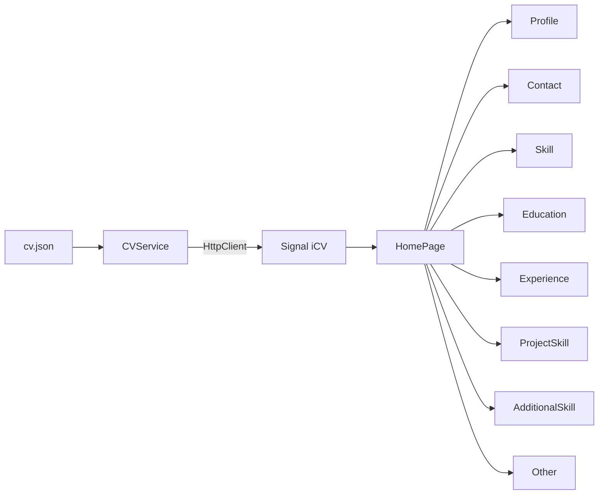

# Portafolio Frontend


Aplicación SPA desarrollada con **Angular 21** que presenta un currículum profesional de forma dinámica. La interfaz está construida con **componentes standalone**, **signals** y **Tailwind CSS**, y toma todo su contenido desde un modelo JSON tipado que replica el contrato de la API del portafolio.

El objetivo del proyecto es servir como frontend del portafolio personal y, al mismo tiempo, aplicar buenas prácticas de Angular moderno: separación de contenido y presentación, componentes reutilizables, estado reactivo y un contrato de datos fuertemente tipado.

---

## Características

- Renderizado dinámico de todas las secciones del currículum desde un único archivo JSON.
- Componentes standalone independientes por sección, sin `NgModules`.
- Estado reactivo con `signal` y `computed` para la carga y transformación de datos.
- Habilidades organizadas por categoría y con jerarquía padre/hijo ilimitada.
- Formateo recursivo de habilidades anidadas, por ejemplo `C# (.NET 6 | .NET 8)`.
- Contactos con enlaces `tel:`, `mailto:`, `url` y `whatsapp`, ordenados por posición.
- Diseño responsive con Tailwind CSS.
- Carga diferida de la página principal mediante `loadComponent`.
- Título del documento generado a partir de los datos del perfil.
- Cabeceras de seguridad listas para hosting estático.

---

## Stack tecnológico

| Tecnología         | Uso                                              |
| ------------------ | ------------------------------------------------ |
| Angular 21         | Framework de la SPA                              |
| TypeScript 5.9     | Tipado estricto del modelo y los componentes     |
| Tailwind CSS 4     | Estilos utilitarios y diseño responsive          |
| Angular HttpClient | Carga del archivo de datos del currículum        |
| Angular Signals    | Estado reactivo de la aplicación                 |
| Vitest             | Runner de pruebas configurado mediante `ng test` |
| Prettier           | Formato consistente del código                   |

---

## Arquitectura

La aplicación es una SPA sin backend propio: al iniciar, un servicio carga el currículum desde un JSON local y lo expone mediante un `signal` que alimenta la vista principal.



### Flujo de renderizado

```text
HTTP GET assets/data/cv.json
        │
        ▼
CVService (signal<iCV | null>)
        │
        ▼
HomePage (effect para el título)
        │
        ├── app-profile
        ├── app-contact
        ├── app-skill
        ├── app-education
        ├── app-experience
        ├── app-project-skill
        ├── app-additional-skill
        └── app-other
```

1. `CVService` solicita el JSON y actualiza el signal `cv`.
2. `HomePage` reacciona al cambio y compone las secciones con `@if` y `@for`.
3. Cada componente recibe su parte del modelo mediante `input.required<T>()`.
4. Los datos se transforman solo cuando es necesario, por ejemplo al ordenar contactos o al construir el árbol de habilidades.

---

## Estructura del proyecto

```text
portafolio-frontend/
├── public/
│   ├── _headers
│   └── assets/
│       ├── data/cv.json          # no versionado (datos personales)
│       ├── icons/
│       └── images/profile.png    # no versionado (dato personal)
├── src/
│   ├── app/
│   │   ├── features/cv/
│   │   │   ├── components/
│   │   │   ├── interfaces/
│   │   │   ├── services/
│   │   │   └── utils/
│   │   ├── pages/home-page/
│   │   ├── app.config.ts
│   │   ├── app.routes.ts
│   │   └── app.ts
│   ├── main.ts
│   └── styles.css
├── angular.json
├── package.json
└── tsconfig.json
```

---

## Modelo de datos del currículum

El contenido se obtiene desde `public/assets/data/cv.json`. Cada sección tiene su interfaz en `src/app/features/cv/interfaces` y su componente asociado:

| Sección JSON      | Componente        | Contenido                                                        |
| ----------------- | ----------------- | ---------------------------------------------------------------- |
| `profile`         | `Profile`         | Datos generales, cargo y presentación.                           |
| `contact`         | `Contact`         | Medios de contacto con enlaces según su tipo.                    |
| `education`       | `Education`       | Formación académica y certificaciones.                           |
| `categorySkill`   | `Skill`           | Competencias técnicas agrupadas por categoría.                   |
| `experience`      | `Experience`      | Experiencia laboral y tecnologías utilizadas.                    |
| `projectSkill`    | `ProjectSkill`    | Proyectos y habilidades aplicadas.                               |
| `additionalSkill` | `AdditionalSkill` | Conocimientos adicionales.                                       |
| `other`           | `Other`           | Información complementaria (idioma, modalidad, ubicación, etc.). |

El modelo JSON replica el contrato de la API REST del repositorio `portafolio-backend`, lo que permite migrar el frontend al consumo directo de la API sin rediseñar la vista.

### Habilidades jerárquicas

Las habilidades pueden tener hijos de forma recursiva. La utilidad `formatSkills` en `src/app/features/cv/utils/skill.utils.ts` transforma el árbol en texto legible:

```text
C# (.NET 6 | .NET 8 (ASP.NET Core | EF Core))
```

---

## Decisiones de diseño

- **Contenido separado de la vista:** toda la información vive en un JSON, por lo que actualizar el currículum no requiere recompilar componentes.
- **Componentes standalone:** cada sección es independiente y declara sus propias dependencias.
- **Signals:** el estado del currículum se gestiona con `signal`, evitando suscripciones manuales en la vista.
- **Contrato tipado:** las interfaces reflejan el JSON y el contrato de la API, lo que detecta errores en tiempo de compilación.
- **Utilidades puras:** el formateo de habilidades está aislado en funciones reutilizables y fáciles de probar.
- **Privacidad por defecto:** los archivos con datos personales no se versionan; se proporcionan en el entorno local o de despliegue.
- **Seguridad:** `public/_headers` define políticas de seguridad para el hosting estático.

---

## Puesta en marcha

### Requisitos

- [Node.js](https://nodejs.org/) 20.19+ o 22.12+
- npm 11+

### 1. Instalar dependencias

```bash
npm install
```

### 2. Preparar los datos locales

Crea los siguientes archivos, que no se versionan por contener información personal:

```text
public/assets/data/cv.json
public/assets/images/profile.png
```

El JSON debe respetar las interfaces definidas en `src/app/features/cv/interfaces`.

### 3. Ejecutar el servidor de desarrollo

```bash
npm start
```

La aplicación estará disponible en `http://localhost:4200/` y se recargará automáticamente al modificar los archivos fuente.

---

## Build

```bash
npm run build
```

Los artefactos de producción se generan en `dist/portafolio-frontend/browser`. El archivo `_headers` se copia automáticamente a la raíz del build.

---

## Pruebas

```bash
npm test
```

Vitest está configurado a través del builder de Angular. La cobertura de pruebas está pendiente (ver estado del proyecto).

---

## Despliegue

La aplicación se puede desplegar en cualquier hosting estático. Para Cloudflare Pages o Netlify:

| Configuración    | Valor                              |
| ---------------- | ---------------------------------- |
| Build command    | `npm run build`                    |
| Output directory | `dist/portafolio-frontend/browser` |

Consideraciones:

- `_headers` es compatible con Cloudflare Pages y Netlify.
- Los archivos `cv.json` y `profile.png` deben existir durante el build. Si el despliegue se ejecuta desde el repositorio, deben generarse en un paso previo o inyectarse desde secretos del CI.
- Al ser una SPA, conviene redirigir las rutas desconocidas a `index.html` si se agregan rutas adicionales.

---

## Estado del proyecto

- [x] Renderizado dinámico del currículum desde JSON tipado.
- [x] Componentes standalone con signals.
- [x] Habilidades jerárquicas con formato recursivo.
- [x] Contactos con enlaces según su tipo.
- [x] Diseño responsive con Tailwind CSS.
- [x] Carga diferida de la página principal.
- [x] Cabeceras de seguridad para hosting estático.
- [ ] Pruebas unitarias.
- [ ] Consumo directo de la API REST del backend.
- [ ] Expandir/colapsar experiencias.
- [ ] Iconos para contactos y habilidades.
